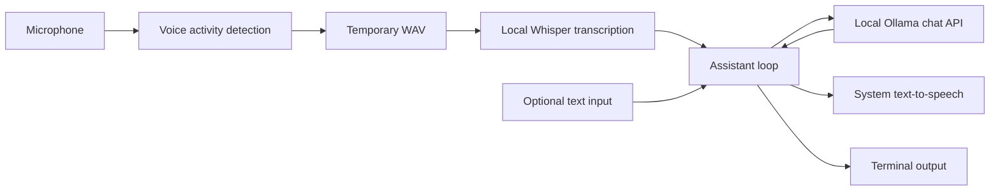

# Voice AI Assistant

A local-first desktop voice assistant. It records speech from your microphone, transcribes it with OpenAI Whisper running locally, sends conversation context to a local Ollama model, and reads the answer with the operating system's speech engine.

## What it does

- Voice activity detection ends a recording after silence, with a configurable maximum duration.
- Whisper is loaded only when voice mode starts and cached for subsequent turns.
- Ollama's chat API receives role-aware conversation history, bounded to a configurable number of turns.
- Answers are spoken with `pyttsx3` in voice mode.
- `--text` mode exercises the conversation without a microphone or speakers.
- Configuration is read from environment variables; defaults are suitable for a local Ollama installation.
- Service and device errors are logged and reported while keeping the interactive session available.

## Architecture



| Path | Responsibility |
| --- | --- |
| `main.py` | Interactive voice/text loop and user-facing error handling |
| `src/settings.py` | Validated environment configuration |
| `src/recorder.py` | Microphone capture and voice activity detection |
| `src/speech_to_text.py` | Lazy, cached Whisper transcription |
| `src/llm.py` | Ollama HTTP client and bounded in-memory context |
| `src/text_to_speech.py` | System speech synthesis |
| `tests/` | Unit tests for settings and Ollama behavior |

## Requirements

- Python 3.10 or newer
- Ollama installed and running locally, with the configured model downloaded
- A working microphone and audio output for voice mode
- Whisper's first run downloads the selected model weights; subsequent runs use the local cache

## Install and run

Create and activate a virtual environment, then install dependencies:

```powershell
py -3 -m venv .venv
.venv\Scripts\Activate.ps1
python -m pip install --upgrade pip
python -m pip install -r requirements.txt
Copy-Item .env.example .env
```

Install/start Ollama, then pull the default model:

```powershell
ollama pull llama3.2:3b
ollama serve
```

In another terminal, start voice mode:

```powershell
python main.py
```

Use typed input without audio hardware:

```powershell
python main.py --text
```

Say or type `exit`, `quit`, or `stop` to leave. The first Whisper model load can take time and memory. Use a smaller `WHISPER_MODEL` such as `tiny` on constrained hardware.

## Configuration

Copy `.env.example` to `.env`. `.env` is ignored by Git. Settings are also read directly from the process environment.

| Variable | Default | Purpose |
| --- | --- | --- |
| `OLLAMA_URL` | `http://localhost:11434` | Ollama base URL |
| `OLLAMA_MODEL` | `llama3.2:3b` | Model already pulled in Ollama |
| `OLLAMA_TIMEOUT` | `120` | HTTP request timeout in seconds |
| `WHISPER_MODEL` | `base` | Local Whisper model (`tiny`, `base`, `small`, `medium`, `large`) |
| `SAMPLE_RATE` | `16000` | Microphone sample rate in Hz |
| `AUDIO_CHANNELS` | `1` | Number of microphone channels |
| `SILENCE_THRESHOLD` | `500` | RMS level for detecting speech (int16 scale) |
| `SILENCE_DURATION` | `1.5` | Silence seconds that end a recording |
| `MAX_RECORDING_SECONDS` | `10` | Maximum duration of one recording |
| `CONVERSATION_TURNS` | `12` | Recent exchanges held in memory |
| `LOG_LEVEL` | `INFO` | Python logging level |

## Development and CI

Run the unit tests and syntax compilation:

```powershell
python -m unittest discover -s tests -v
python -m compileall -q main.py src tests
```

GitHub Actions runs these checks for pushes and pull requests. Tests mock Ollama and do not require a model download, a running server, or audio hardware. Full voice integration should be checked on the target machine with a working microphone, speakers, Whisper model, and Ollama model.

## Security and privacy

- Speech recognition and language-model inference are configured for local services. Ollama is called at `OLLAMA_URL`; point it only to a trusted endpoint.
- Audio is written to a temporary WAV and deleted after transcription. A process crash can leave a temporary file behind; inspect your OS temporary directory if recovery matters.
- Conversation context remains in process memory and is not persisted by this application.
- Do not commit `.env`, credentials, audio recordings, or downloaded model weights. Never expose Ollama's unauthenticated local API directly to an untrusted network.
- The app is a single-user local desktop tool. It has no account system, remote API, database, or role-based access control to secure.

## Current boundaries and roadmap

The implementation is intentionally local and single-user. It does not include cloud deployment, Docker audio passthrough, persistent chat history, model training/registry, experiment tracking, analytics, or drift monitoring; those do not fit an application that consumes pretrained local models and host audio devices. A practical next step is adding selectable audio input devices and an explicit conversation reset command. CI validates unit behavior and syntax, while microphone, TTS, and Ollama integration remain hardware/service checks on a configured workstation.
